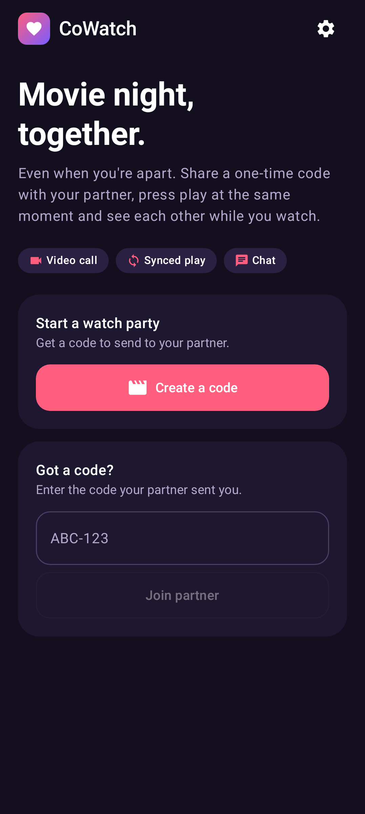
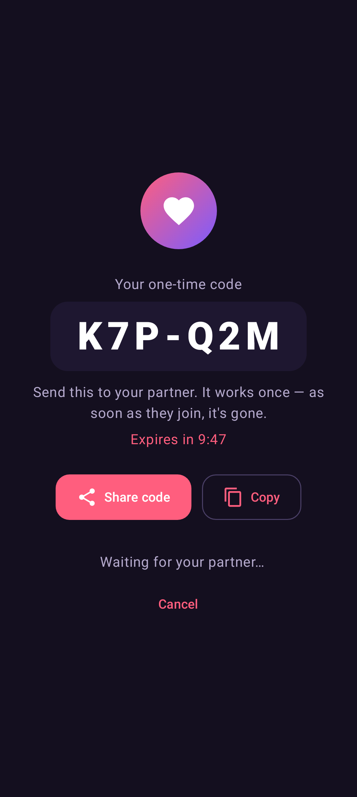
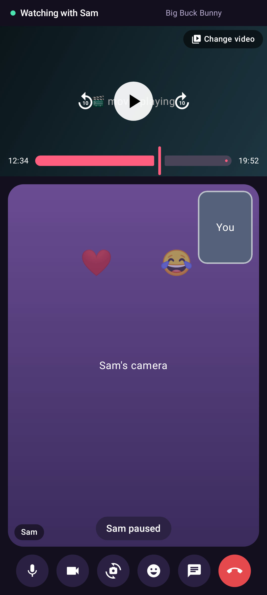
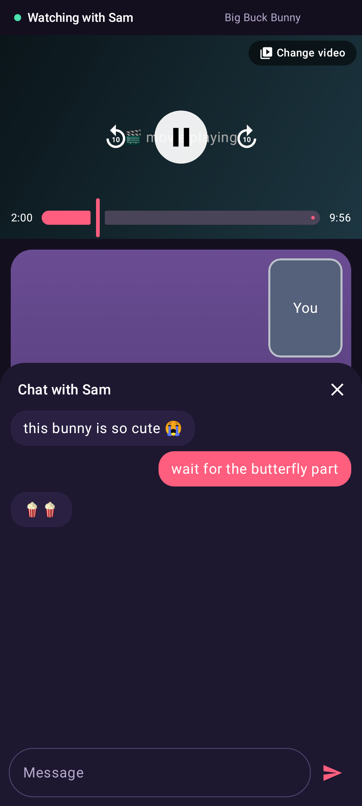
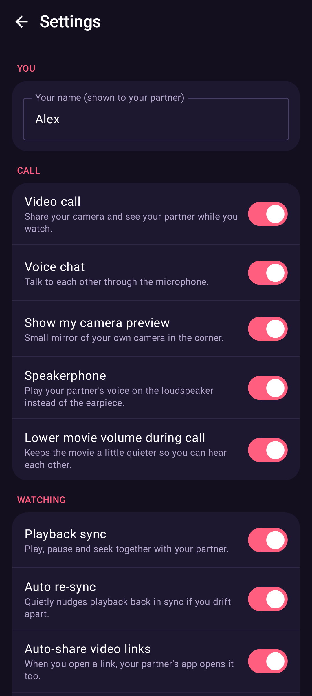

# CoWatch 🍿

Watch a movie together with your partner, even when you're apart: pair with a
**one-time code**, press play at the same moment, and see and hear each other
on a video call while you watch.

| Home | Your code | Watching | Chat | Settings |
|---|---|---|---|---|
|  |  |  |  |  |

## How it works

1. **P1** taps *Create a code* and gets a code like `K7P-Q2M` (share sheet, copy, or a `cowatch://join/K7PQ2M` link).
2. **P2** types the code and taps *Join partner*.
3. The phones connect **directly** (WebRTC, peer-to-peer). The code is burned the moment P2 joins
   and expires after 10 minutes if nobody uses it.
4. Open a movie: paste a video link (it opens on both phones automatically) or pick a video from
   your phone — it is **streamed to your partner's phone over the call**, with seeking. Use
   **Change video** on the player to switch or stop. Play / pause / seek are mirrored on both phones,
   and the host's position is used to quietly correct drift.
5. Video call, mic/camera toggles, text chat and floating emoji reactions all ride along.

No account and no backend of our own: pairing uses the free public PeerJS signaling server
(`0.peerjs.com`) only to exchange the connection offer, then everything goes phone-to-phone.
You can point it at your own `peerjs-server`, STUN and TURN servers in **Settings → Connection**.

## Feature switches

Every feature has its own on/off switch in **Settings** (generated from `Feature` in
`app/src/main/java/com/cowatch/app/settings/FeatureSettings.kt` — add an entry there and it gets a toggle):

| Feature | Default |
|---|---|
| Video call · Voice chat · Show my camera preview · Speakerphone · Lower movie volume during call | on |
| Playback sync · Auto re-sync · Auto-share video links · Stream my videos to partner · Keep screen on | on |
| Text chat · Emoji reactions · Vibrate on partner activity | on |
| Codes expire after 10 minutes | on |

Dependent features (e.g. *Auto re-sync* needs *Playback sync*) are greyed out when their parent is off.

## Build & test

GitHub Actions (`.github/workflows/build.yml`) runs on every push: unit tests, renders screenshots,
builds debug + release APKs and uploads them as workflow artifacts.

Locally (JDK 17+, Android SDK 35):

```bash
./gradlew testDebugUnitTest        # logic tests
./gradlew recordRoborazziDebug     # render every screen to screenshots/*.png (Robolectric, no emulator)
./gradlew assembleDebug            # app/build/outputs/apk/debug/app-debug.apk
```

Screenshots in `screenshots/` are re-rendered and reviewed before each push.

## Known limitations

- Without a TURN server, some strict mobile/corporate networks can't connect peer-to-peer. Add one in Settings.
- The call runs while the app is open; there's no background/PiP mode yet.
- Streaming-service apps (Netflix etc.) can't be embedded — use direct video links or local files.
- Movie audio and voice share the phone speaker; headphones give the best experience.
- Streaming a phone video to your partner needs upload speed above the video's bitrate; on a slow
  connection it will pause to buffer.
